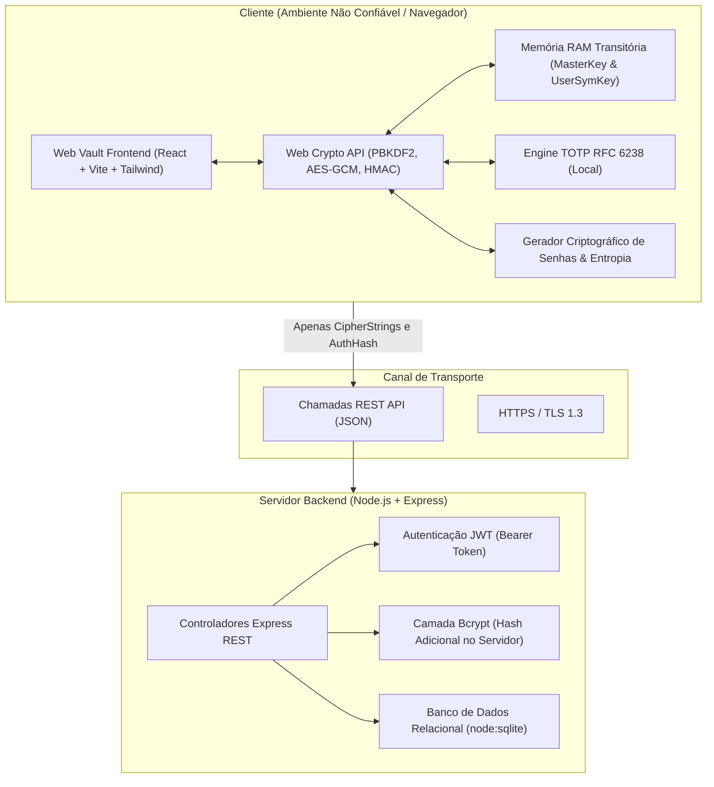

# Arquitetura do Sistema: Réplica Acadêmica do Vaultwarden

Este documento detalha a arquitetura do **Vaultwarden Academic Replica**, um sistema completo de gerenciamento de senhas desenvolvido com foco em privacidade absoluta sob o modelo de **Conhecimento Zero (*Zero-Knowledge Architecture*)**.

---

## 1. Visão Geral da Arquitetura

O sistema é dividido estritamente em duas camadas com fronteiras de confiança (*Trust Boundaries*) bem definidas:

---

## 2. Fronteiras de Confiança (Trust Boundaries)

| Componente | Nível de Confiança | Dados Acessíveis | O que NUNCA Acessa |
| :--- | :--- | :--- | :--- |
| **Navegador do Usuário** | Zona de Confiança Máxima | Senha Mestra, MasterKey, Chave Simétrica, Texto Claro dos Itens | Estado de outros usuários |
| **Canal de Rede** | Não Confiável | Apenas `MasterPasswordHash` e `CipherStrings` cifrados | Senha Mestra, MasterKey, Dados em claro |
| **Servidor Node.js** | Semi-Confiável (*Blind Storage*) | E-mail, Metadados (KDF, contadores, timestamps), CipherStrings cifrados | Senha Mestra, MasterKey, Chave Simétrica, Dados em claro |
| **Banco SQLite** | Armazenamento Cego | Linhas contendo hashes Bcrypt e textos cifrados | Qualquer informação confidencial inteligível |

---

## 3. Modelo de Dados no SQLite

O banco de dados SQLite armazena única e exclusivamente dados criptografados:

### Tabela `users`
- `id` (TEXT PRIMARY KEY - UUID)
- `email` (TEXT UNIQUE NOT NULL - normalizado em minúsculas)
- `master_password_hash` (TEXT NOT NULL - hash Bcrypt do `MasterPasswordHash` do cliente)
- `master_password_hint` (TEXT NULL - dica cadastrada pelo usuário)
- `encrypted_symmetric_key` (TEXT NOT NULL - chave simétrica do usuário cifrada com a MasterKey)
- `kdf` (INTEGER NOT NULL DEFAULT 0 - 0 = PBKDF2_SHA256)
- `kdf_iterations` (INTEGER NOT NULL DEFAULT 600000)
- `created_at`, `updated_at` (TEXT ISO 8601)

### Tabela `ciphers`
- `id` (TEXT PRIMARY KEY - UUID)
- `user_id` (TEXT NOT NULL - FK `users.id`)
- `folder_id` (TEXT NULL - FK `folders.id`)
- `type` (INTEGER NOT NULL - 1=Login, 2=SecureNote, 3=Card, 4=Identity)
- `favorite` (INTEGER NOT NULL DEFAULT 0)
- `name` (TEXT NOT NULL - **CipherString** cifrada)
- `notes` (TEXT NULL - **CipherString** cifrada)
- `encrypted_data` (TEXT NOT NULL - **CipherString** contendo JSON cifrado)
- `reprompt` (INTEGER NOT NULL DEFAULT 0)
- `deleted_date` (TEXT NULL - timestamp de exclusão para lixeira)
- `created_at`, `updated_at` (TEXT ISO 8601)

### Tabela `folders`
- `id` (TEXT PRIMARY KEY - UUID)
- `user_id` (TEXT NOT NULL - FK `users.id`)
- `name` (TEXT NOT NULL - **CipherString** cifrada)
- `created_at`, `updated_at` (TEXT ISO 8601)

---

## 4. Gerenciamento do Ciclo de Vida da Memória

1. **Desbloqueio (Unlock)**:
   - A senha mestra é informada pelo usuário.
   - O PBKDF2 deriva a `MasterKey`.
   - A `MasterKey` decifra a `UserSymmetricKey`.
   - Ambos os objetos `CryptoKey` residem temporariamente no heap de execução do JavaScript.

2. **Bloqueio (Lock / Auto-Lock)**:
   - Disparado manualmente ou por inatividade (tempo configurável: 1 min, 5 min, 15 min, etc.).
   - A referência a `UserSymmetricKey` e `MasterKey` é sobrescrita para `null`.
   - O coletor de lixo (Garbage Collector) expurga o material da memória RAM.
   - Mesmo que um invasor tenha acesso físico ao navegador aberto, nada pode ser decifrado sem reintroduzir a Senha Mestra.

